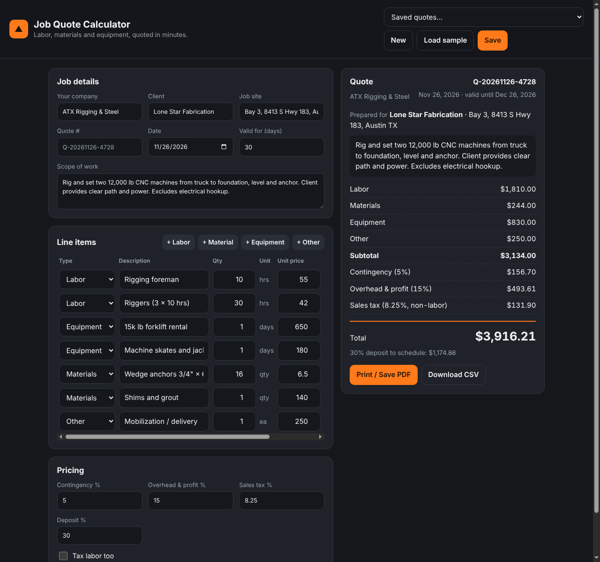
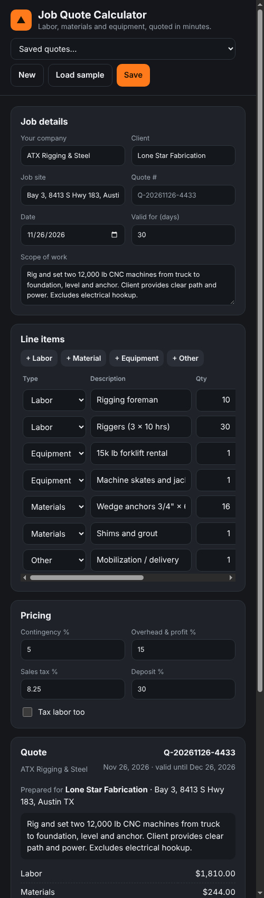

# Job Quote Calculator

A fast, clean quoting tool for contractors and trades: add labor, materials and equipment, set contingency, overhead and profit, tax and deposit, then print the quote or save it as a PDF for the client.

**Live app:** https://cleverpup1994-lgtm.github.io/job-quote-calculator/
**Open with a sample rigging job:** https://cleverpup1994-lgtm.github.io/job-quote-calculator/?sample



## Why I built it

I've worked as a rigger and foreman and done plenty of job walks and quotes. Most small crews still quote out of a notebook or a messy spreadsheet. This tool does the math the way contractors actually price a job, and it turns the result into something you can hand a client.

## Features

- **Line items** for labor (hours), materials (qty), equipment (days) and other costs, each with a live line total
- **Pricing that matches how jobs get quoted:** subtotal, then contingency, then overhead and profit, then sales tax
- **Tax on materials and equipment only** by default (labor is often non-taxable), with a "Tax labor too" switch
- **Deposit** amount calculated automatically
- **Print / Save as PDF** prints only the client-facing quote, in black on white
- **CSV export** of the line items for spreadsheets or accounting
- **Save and reopen quotes** in the browser, with no account or server needed
- **Works on phones**, so you can build a quote from the job site
- **Plain HTML, CSS and JavaScript**, with no frameworks and nothing to install



## How it's built

```
index.html          Layout and the printable quote
src/quote.js        All the math, with no DOM; unit-tested
src/app.js          UI: one quote object as the source of truth, re-rendered on change
src/styles.css      Dark job-site theme, responsive layout, print styles
tests/              Node test runner unit tests
```

- **Money is calculated in whole cents**, so totals never drift by a penny (no `0.1 + 0.2` bugs).
- **The math is separate from the UI**, which makes it easy to test and easy to reuse in a mobile app or backend.
- **Safe rendering:** user-typed text is added as text nodes, never as HTML.
- **Storage is optional:** if the browser blocks local storage, the app still works and just can't save.
- **CI:** every push runs the tests, then deploys to GitHub Pages (`.github/workflows/pages.yml`).

## Run it locally

```bash
npm test                      # run the unit tests (Node 20+)
python3 -m http.server 8000   # then open http://localhost:8000
```

---

© 2026 Abel Rios / Habex Studios. All rights reserved. This code is shared so people can review my work. It's not licensed for reuse.
